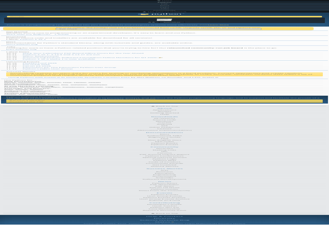

<p align="center"></p>

# Diting

English | [中文](README.zh-CN.md)

**The Browser for AI Agents. See the live web. Read it. Act on it. Remember it.**

[](LICENSE)
[](https://github.com/yinnho/diting/releases/latest)
[](https://skills.sh/yinnho/diting)
[](https://x.com/diting)

A browser built for agents from the first line of code — not a human browser bolted onto automation. See the world, read it, search it, act on it, and keep what you read: one Rust binary with built-in V8, **no Chromium required**.

> Humans have Chrome. Agents have Diting.

One binary, zero dependencies, instant service. The HTTP API is the whole interface — agents plug in and go.

<video src="https://github.com/yinnho/diting/releases/download/v0.7.0/diting-vs-competitors.mp4" controls muted width="720"></video>

*Historical clip from the [v0.7.0](https://github.com/yinnho/diting/releases/tag/v0.7.0) release assets (current release is [v0.7.0](https://github.com/yinnho/diting/releases/tag/v0.7.0)). The star that got our attention: Pierre Tachoire, co-founder of [Lightpanda](https://lightpanda.com) — the headless browser our [bench](bench/README.md) measures against — starred the repo. 90 seconds on why that mattered to us.*

*Real pages rendered by Diting's diting engine (no Chromium) — Wikipedia, this repo, Rust. [Screenshot it yourself →](docs/API.md#screenshot)*



## Why Agents Need Their Own Browser

Measured against headless Chrome on the same 20 pages, same network ([bench](bench/README.md), 2026-08-28): **7.6× faster** to agent-usable text (p50 532 ms vs 4 053 ms), **~10× less memory** (227 MB for the whole process vs ~2.1 GB per Chrome page), and 0 hard failures where Chrome's `--dump-dom` produced no DOM on 5 of 40 loads. Re-run on v0.5.21 (2026-09-29) on a degraded-network day held the ratio — 5.4× p50, 468 MB whole-run vs 1.75 GB per page — both raw TSVs are in the bench directory (those runs are historical; the current release is [v0.7.0](https://github.com/yinnho/diting/releases/tag/v0.7.0)). An agent's total cost is browser efficiency × model efficiency — this is the browser half.

Existing "browser automation" was built for humans or for one-shot scraping — not for agents:

| | Diting | Puppeteer/Playwright | Firecrawl | Browser-use |
|---|---|---|---|---|
| Designed for | **Agents first** | Human debugging | Scraping service | LLM wrapper |
| Dependencies | Single binary, no Chromium | Chromium ~500MB | Docker ~1GB | Chromium |
| Sees (screenshots) | ✅ built-in diting rendering engine | Needs Chromium | ❌ | Needs Chromium |
| Reads | markdown + js_extract + fetch receipts | DIY | markdown | DIY |
| Writes documents | ✅ `render_markdown`: deterministic HTML + inline-SVG diagrams | ❌ | ❌ | ❌ |
| Finds (search) | ✅ 20 engines, 7 categories, merged | ❌ | ❌ | ❌ |
| Acts | indexed session interaction | DevTools API | ❌ | LLM-driven |
| Remembers | ✅ local fetch/search cache (SQLite FTS5) | ❌ | crawl cache | ❌ |
| Protocol | HTTP | Node API | HTTP | Python |
| TLS fingerprints | ✅ Chrome/Firefox/Safari/Edge | Plugin required | ❌ | ❌ |
| CAPTCHA | ✅ detect + auto-wait + optional 2captcha | DIY | ❌ | ❌ |
| Interactive sessions | ✅ persistent | ✅ | ❌ | ✅ |

Same-tier engines, not the tools in the table above. Cells are capabilities, not speed.

| | Diting | Obscura | Blitz | Lightpanda |
|---|---|---|---|---|
| What it is | Rust browser, V8, diting CSS paint | Rust headless browser, V8 | HTML/CSS engine (Stylo). Not an agent browser | Zig headless browser, V8 |
| Screenshot | built-in paint, opt-in build | screenshots, screencast, PDF | paints a window | Hermes integration falls back to Chrome for screenshots |
| Public CSS suite | none in CI | not published as WPT | WPT in CI, including SVG | not published as WPT |
| License | Apache-2.0 | Apache-2.0 | Apache-2.0 and MIT | AGPL-3.0 |

An agent needs five things from a browser: **see, read, find, act, remember.** One binary covers them all — systemd-friendly, zero dependencies.

**Core advantage: no Chromium.** Diting inlines a full browser engine (V8 + Rust HTTP stack + the diting CSS/layout/paint rendering engine, with the Blitz/Stylo/Taffy lineage as its reference implementation). From v0.6.0 the JS event loop lives in the owned `diting_runtime` crate (`deno_core` retired). No Puppeteer, no Chrome, no Docker. One Rust binary under systemd is your agent browsing infrastructure.

## Two Things Stateless Renderers Can't Do

Most new "agent browsers" are stateless, fingerprint-less one-shot renderers — fine for public pages, dead on arrival against Cloudflare or login flows. Diting goes the opposite way:

- **🔐 Real TLS fingerprints** — stealth mode replicates Chrome / Firefox / Safari / Edge TLS handshakes via BoringSSL (JA3 preset names such as `chrome145`, `firefox133` — not just a UA string), switchable per request. The fleet User-Agent and the default TLS shape are one coherent pair: **Chrome/145** over the `chrome145` preset — UA and ClientHello agree by construction (deliberately 145: some edges route UA majors non-monotonically and wreq-util presets stop at 149; 145 is the only production-routed major a real preset backs). Cloudflare Turnstile challenges wait automatically for `cf_clearance`. Fingerprint-less engines eat 403s — we get through.
- **Evidence:** public Stealth/TLS comparison (JA4 / Akamai H2 vs curl & Chrome, Kitesurf/Lightpanda cited not-run)
- **Scoreboard:** tip micro-bench (cold start, `/fetch` shortset, session snapshot) vs curl/Chrome; Lightpanda/Obscura **not run**
- **🤝 Stateful interactive sessions** — login state injectable and exportable (`session_create(cookies=...)` ↔ `session_cookies`), surviving pagination and multi-step flows; `persistent: true` even survives idle eviction and server restarts — the same session id comes back logged in. One-shot engines throw state away.

> Reference point: Cloudflare's Kitesurf explicitly ships neither real TLS-fingerprint negotiation nor persistent auth sessions — anti-bot and login territory is exactly where Diting plays.

Apache-2.0 open source, single binary — self-host today, no cloud lock-in.

## Every Fetch Is a Receipt

Agents act on what a browser tells them, so the response reports what actually happened — not just "got a 200":

- **`tier`** — which path served the page: plain HTTP (~100 ms) or the V8-rendered browser tier. An agent can see *why* a fetch was fast or slow.
- **`redirected_from`** — the full redirect trail. `redirected_from[0]` is the URL you asked for, `url` is where the content actually came from — requested paired with effective, every hop visible.
- **`content_hash` + `changed_since_prev`** — every fetch is hashed; consecutive samples of the same URL can be diffed. A rate-limited origin serving the same frozen 200 body for days reads as `changed_since_prev: false` — the cheapest drift detector there is.
- **`captcha_event`** — when a challenge page was detected (and solved, if a solver is configured), the response says so instead of handing over a challenge page as if it were content.

The [local cache](#capabilities) builds on the same idea: search hits come back with `[§ heading]` section prefixes so an agent knows *where on the page* a hit landed, and ranking fuses keyword relevance with freshness.

## Capabilities

- **Tiered rendering**: static pages over plain HTTP (~100ms); V8 spins up only when JS rendering is needed (~1-2s) — 90% of the [bench](bench/README.md) page set served without spinning up V8 at all; every response reports which tier served it (`tier` field)
- **Multi-engine meta-search**: general web (Baidu / Bing / Sogou / WeChat / DuckDuckGo / Wikipedia / Hacker News), news (Bing News), code (Stack Overflow, GitHub, MDN), packages (npm, PyPI, RubyGems), academic (arXiv, OpenAlex), AI models (Hugging Face) — 20 engines across 7 categories, queried concurrently, merged and deduplicated. Operators can plug a private Meilisearch index into the same `/search`. Search → read in one step
- **Image search**: `categories=images` hits Baidu/Bing image indexes and returns direct binary `image_url` links (downloadable straight to jpg/png) plus `source_url` provenance
- **Interactive sessions**: persistent browser sessions with indexed interaction (`state/click/input/scroll/eval`) — agents browse like humans do, and `session_export` turns what an agent figured out into a runnable curl replay script (zero model tokens on re-run) — or, with `format=json`, into a flow document (`flow_run` replays it server-side with `{{var}}` substitution, `wait`/`expect` gates and saved outputs; installed flows live in `workflow/<name>/flow.json`, dropped in without a rebuild). Session tools also cover the acting part: `session_viewport` simulates device viewports (media queries respond), `session_wait` blocks on a selector or predicate with a timeout, `session_screenshot` renders the live state, `session_console` replays the page's console ring, and `session_storage` exports/restores cookies plus localStorage for login hand-off
- **Playback-link sniffer**: `session_network(filter=media)` extracts the m3u8/mp4/dash URLs a page's player *actually requested* at runtime — links found only in page HTML are often decoys, so the request log is the source of truth. `GET /session/{id}/har` exports the same traffic as HAR 1.2 (retained bodies included)
- **File download**: streaming to disk (no memory buffering), SHA-256 integrity, resume of interrupted transfers — for binaries, archives, datasets
- **Local cache that remembers**: every fetch/search lands in SQLite (FTS5) at `~/.diting/cache.db` — a re-fetch inside the TTL answers from what the agent already read instead of re-paying network time, with CJK substring matching, `[§ heading]` section-aware snippets, per-URL content hashes for drift detection, and per-session scoping for shared deployments
- **CAPTCHA handling**: type detection with automatic Cloudflare challenge wait and optional 2captcha integration — search never stalls on verification pages
- **JS data extraction**: `js_extract` pulls `window.__INITIAL_STATE__` and other structured data out of SPAs
- **Document generation**: `POST /render_markdown` turns markdown into a deterministic, self-contained HTML artifact — the document layer, so agents never write HTML by hand. Prose rides a plain offline shell (no fonts, no scripts); fenced `archify` blocks carry typed zero-coordinate diagram JSON (sequence / workflow / architecture / dataflow / lifecycle families) and render to inline SVG via the layout engine. Same input, same bytes — the receipt carries the sha256 so determinism is verifiable. `theme` (light/dark) and `preset` (classic / signal-flow / blueprint / editorial) bake colors at generation time; `quality: "showcase"` is the delivery gate, grading route crossings, label clearance and rhythm without touching the artifact bytes. Guided-view tabs plus `window.agxViewer` (`focus` / ego / `route` / `reach`) make the artifact interactive. Mermaid sources are the agent's job to translate into archify JSON, not the engine's. Diagram vocabulary adapted from archify (MIT)
- **Screenshot rendering**: `/screenshot` endpoint (opt-in `--features screenshot`) paints the JS-rendered DOM with the diting rendering engine — pure CPU, no Chromium — to PNG. Vision input for agents
- **Timeline video**: `/video` renders a page's animation timelines to MP4 — the page's scripts register GSAP-style timelines in `window.__timelines` (`duration()` + `pause(t)`), each frame seeks to `t=i/fps` and paints the viewport, and the frames pipe into ffmpeg (H.264, yuv420p). Deterministic by construction: no wall clock in the pixel values, same render twice = same MP4. Needs ffmpeg on PATH
- **Page set (PDF/PNG/PPTX/DOCX)**: `/pdf` cuts a rendered page into pages and packages them — print mode paginates at top-level block boundaries (default A4 @96dpi, no half-cut text where a break can land on a block edge), slides mode makes one page per CSS-selector match sized to the element (an HTML deck with one `.slide` per page exports as a real deck). Image-based PDF: per-page JPEG via DCTDecode, hand-rolled PDF 1.4 writer, zero new dependencies. PPTX packages the same pages as one slide per page; DOCX as one page-sized section per page — both hand-rolled OOXML (stored-ZIP writer, fixed timestamps), byte-deterministic, zero new dependencies
- **TLS fingerprint spoofing**: stealth mode impersonates Chrome/Firefox/Safari/Edge TLS shapes (default preset `chrome145`; fleet UA Chrome/145), switchable per request
- **Firecrawl compatible**: `/v1/scrape` endpoint — existing Firecrawl clients migrate by changing the base URL
- **DNS rebinding protection**: built-in SSRF guard + post-resolution IP validation

## A Browser, Not a Crawler

Diting exists for **real-time retrieval**: an agent arrives with a question, reads a handful of pages, leaves with the answer. It is not a crawling tool — and the product is shaped so it can't quietly become one:

- **robots.txt is not our gate.** The RFC 9309 checker ships built in, but a real-time lookup layer isn't a crawler and doesn't do crawler etiquette by default; operators who want it set `DITING_HONOR_ROBOTS=1`.
- **No site-walking API.** There is no crawl endpoint and no link-following recursion — every page load happens because an agent asked for that page.
- **Built-in budgets.** Per-domain: 20 pages/minute. Per interactive session: 200 pages. Toggled via `DITING_DOMAIN_RATE_PER_MIN` / `DITING_SESSION_PAGE_LIMIT` (`0` disables on your own instance). Generous for an agent grinding through docs or a console; fatal to the page-after-page crawl pattern, including subdomain rotation (one registrable domain, one budget).
- **The hosted instance (browser.aginx.net) runs tighter budgets.** Every user shares one egress IP, and keeping sites comfortable with that IP is part of the service. Self-host if you want different numbers.
- Need to bulk-crawl a site? Use a crawler. This isn't one, and it won't become one.

## What It's For

Not demos — real jobs agent browsers are doing today:

- **Grind through admin consoles** — AWS / App Store Connect / Google Play, dozens of menu layers per task. Let the agent click; it comes back only when authorization is needed.
- **Batch actions behind login** — fill carts, dig through order history, check pages that only render while logged in. Inject cookies, operate, export for reuse.
- **Past anti-bot walls** — Cloudflare protection, Turnstile challenges, TLS fingerprint checks. Stealth mode pushes through instead of retreating at 403.
- **The Chinese internet** — Baidu / Sogou / WeChat meta-search across 5 engines, correct Chinese page rendering. Not English-web-only.
- **On-the-spot scripting** — agent reads the page, writes JS, evals it: highlighted comparison tables, reflowed content, product filters on hidden parameters. GreaseMonkey-on-steroids.
- **Multimodal vision** — screenshots as visual input for look-and-judge flows: picking seats, recognizing layouts, verifying rendering.

## Where It Sits in the Computer-Use Stack

Computer-use agents come in two layers. **GUI-layer** stacks (Cua, desktop CUA agents) drive a whole machine: screenshots of a display in, X11 mouse/keyboard events out, a VM or container per session. **Engine-layer** browsers skip the desktop — the page itself is the machine. Diting is the engine layer:

| | GUI layer (desktop CUA) | Diting (engine layer) |
|---|---|---|
| Action space | screen pixels → OS input events | DOM: click by coordinates or selector, real event dispatch |
| State readout | screenshot of a display | structured DOM / accessibility tree, screenshot optional |
| Per-session cost | Xvfb + VM/container | one process, no display server |
| Frames | flattened into pixels | first-class: hit-testing descends into iframes, frame-scoped evaluate |
| Replay | best-effort (compositor timing) | action logs export as runnable curl / flow JSON |


## Quick Start

**One-command full install** (SKILL.md trigger surface + verification):

```bash
# Download -> inspect the contents -> run only after review (never blind-run network scripts)
curl -fsSL https://raw.githubusercontent.com/yinnho/diting/main/skill.sh -o skill.sh
less skill.sh
bash skill.sh
```

**Install the skill trigger surface via [skills.sh](https://www.skills.sh)**:

```bash
npx skills add yinnho/diting
```

**Or just hand this block to your AI agent** — it sets itself up:

```text
Set up diting as your web access layer:
1. Install v0.7.0 locally and verify it is healthy:
   # Preferred — current release binary (install.sh picks the platform):
   curl -fsSL https://browser.aginx.net/install.sh -o install.sh && less install.sh && bash install.sh
   # Optional Homebrew (tap tracks v0.7.0; still verify with `diting --version`):
   #   brew trust yinnho/diting && brew install yinnho/diting/diting
   diting doctor   # then start: diting (listens on 0.0.0.0:8089)
   curl http://127.0.0.1:8089/health
2. From now on, route web tasks through http://127.0.0.1:8089 instead of raw curl:
   - read a page / scrape a URL  -> POST /fetch {"url":...}        (markdown output, Cloudflare bypassed by default)
   - search the web              -> POST /search {"q":...,"fetch_top":3}
   - see a page                  -> POST /screenshot {"url":...}
   - login / form / click-through-> POST /session/create -> /session/{id}/state -> /input /click -> /close
```

Self-hosting:

```bash
# Prebuilt binary for current release v0.7.0 (platform detect + sha256 + mirror fallback)
# macOS / Linux / Windows (git-bash). Assets: https://github.com/yinnho/diting/releases/tag/v0.7.0
# Cautious: download -> inspect -> run (never blind-run network scripts)
curl -fsSL https://browser.aginx.net/install.sh -o install.sh
less install.sh && bash install.sh
# Or straight in, if you trust the repo:
#   curl -fsSL https://browser.aginx.net/install.sh | sh
# GitHub slow/blocked? DITING_GH_PROXY=https://ghfast.top/ bash install.sh
diting doctor   # features + fonts + egress self-check

# Optional: Homebrew (7+ needs the trust line first). Tap is at v0.7.0 —
# still verify with `diting --version` after install / upgrade.
# brew trust yinnho/diting
# brew install yinnho/diting/diting
# brew upgrade diting

# Or build from source (--features stealth,screenshot or you lose both)
cargo build --release --features stealth,screenshot

# Start the service
./target/release/diting
# → Listening on 0.0.0.0:8089

# Verify
curl http://127.0.0.1:8089/health
# → {"status":"ok","engine":"diting"}

# Fetch a page
curl -sS -X POST http://127.0.0.1:8089/fetch \
  -H "Content-Type: application/json" \
  -d '{"url":"https://example.com"}'

# Search (snippets only by default; fetch_top grabs page bodies for the top N)
curl -sS -X POST http://127.0.0.1:8089/search \
  -H "Content-Type: application/json" \
  -d '{"q":"macbook price","max_results":5,"fetch_top":2,"max_chars_per":2000}'

# Create an interactive session
curl -sS -X POST http://127.0.0.1:8089/session/create \
  -H "Content-Type: application/json" \
  -d '{"url":"https://example.com"}'
# → {"session_id":"s_1","url":"https://example.com/"}
```

## The DupHub market: pay per outcome, not per flow

From v0.7.1 diting connects to **[duphub.com](https://duphub.com)** — the capability market for agents. The goods are **flows** (multi-step operations: login, publish, order, price-watch…) and **panel templates**; the consumer is the agent, not the human. **Pulls are free; you pay per successful outcome** — a publish that lands is one charge, whether a flow did it, the agent drove the session by hand, or raw session API calls did (the session-level observer sees all paths equally). The human does exactly one thing: **scan the recharge QR code the agent holds up**.

```bash
# 1. Activate (one-time; key from duphub.com's Keys page — code = wallet = identity)
curl -X POST http://127.0.0.1:8089/activation/activate \
  -H 'Content-Type: application/json' -d '{"code": "oc_YOUR_KEY"}'
# → {"balance_cents": 10000}

# 2. Run a market flow (absent locally? pulled into MEMORY — encrypted in
#    transit and at rest, decrypted in-process, never touches disk — and a
#    task arms automatically; the receipt carries the billing block)
curl -X POST http://127.0.0.1:8089/flow/run \
  -H 'Content-Type: application/json' -d '{"name": "xhs-post", "vars": {...}}'
# receipt.task: {state:"settled", charged_cents:100, balance_cents:9900, ...}

# 3. Manual work bills the same: arm a task on a live session, work it,
#    finish with the success count
curl -X POST http://127.0.0.1:8089/task/start \
  -H 'Content-Type: application/json' -d '{"anchor":"taobao-publish","session_id":"s_1"}'
curl -X POST http://127.0.0.1:8089/task/finish \
  -H 'Content-Type: application/json' -d '{"task_id":7,"successes":1,"session_id":"s_1","share_evidence":true,"evidence":{"final_url":"..."} }'
```

- **Billing equals outcomes**: no signature hit → the hold is refunded automatically; N successes settle N× the per-outcome price (capped at the hold)
- **Know-how is encrypted end-to-end**: flow bodies are AES-256-GCM ciphertext at rest and on the wire; the per-flow key rides the authenticated manifest — plaintext exists only inside a diting process
- **Low balance enters the recharge loop automatically**: `POST /activation/topup` returns a QR code → the agent shows it to the owner via `/open` (qr panel template) → owner scans and pays (WeChat) → the agent polls `POST /activation/order` until paid and continues on its own
- **Your task outcomes flow back** (the capability loop): outcomes feed the platform's repair/incubation/demand queues; evidence uploads only when the owner says yes (`share_evidence`) and only whitelisted fields leave the machine. Adopted feedback earns a one-off reward
- Your own `workflow/` flows are untouched (free, offline); self-hosted market: point `DITING_DUPHUB_URL` at your private hub

## REST Routes

Every capability is plain HTTP — no SDK required. There is no `/openapi.json` (the routes are few enough to list here); full request/response fields for each route are in [docs/API.md](docs/API.md).

| Method | Path | What it does |
|---|---|---|
| GET | `/health` | Liveness + build commit, UA, TLS, capabilities |
| GET | `/doctor` | Deep self-check: engines live, fonts, egress |
| GET | `/engines` | Search engine catalog with live suspension state |
| POST | `/fetch` | Fetch a page → text/markdown/html. Params: `render_tier` (`auto`/`http`/`browser`), `max_chars`, `capture_xhr`, … |
| POST | `/search` | Multi-engine meta-search. Params: `engines`, `categories`, `max_results`, `time_range` (`day`/`week`/`month`/`year`), `fetch_top`, `max_chars_per`, `wait_secs` |
| POST | `/click` | Click a CSS selector on a page |
| POST | `/eval` | Evaluate JavaScript on a page |
| POST | `/download` | Stream a file to disk (sha256, resume) |
| POST | `/screenshot` | Render page → PNG (`screenshot` feature) |
| POST | `/video` | Render animation timelines → MP4 (`screenshot` feature) |
| POST | `/pdf` | Paginate page → PDF/PNG/PPTX/DOCX (`screenshot` feature) |
| POST | `/v1/scrape` | Firecrawl-compatible scrape (+ `actions`) |
| POST | `/flow/run` | Run a recorded/edited flow JSON to completion — zero model tokens (`name` runs an installed `workflow/<name>/flow.json`, `flow` is inline, `vars` substitute `{{placeholders}}`, `session_id` composes with imported login state) | — local `workflow/` or the market (`name` auto-prices: free pulls straight, paid buys then runs in memory)
| POST | `/session/create` | Start an interactive session (cookies/UA carried across calls) |
| POST | `/import/curl` | Create a logged-in session from a DevTools "Copy as cURL" |
| GET | `/session/list` | Live sessions |
| POST | `/session/{id}/navigate` · `/state` · `/click` · `/click_xy` · `/drag` · `/input` · `/scroll` · `/eval` · `/wait` · `/dialog` · `/viewport` · `/screenshot` · `/clone` · `/close` | Session actions |
| GET | `/session/{id}/cookies` · `/storage` · `/console` · `/network` · `/har` · `/export` | Session inspection |
| POST | `/render_markdown` | Markdown → deterministic self-contained HTML artifact (+ inline-SVG diagrams) |

Every capability is one POST away — no SDK, no protocol adapter.

## Project Layout

```
diting/
├── ARCHITECTURE.md       # Layering legislation (authoritative)
├── Cargo.toml            # Workspace root (members = crates/diting{,_ops,_runtime})
├── crates/
│   ├── diting/           # Engine crate: DOM/CSS/layout/paint/JS/net/Page
│   │   ├── build.rs      # V8 snapshot generation
│   │   ├── js/           # bootstrap.js + companion scripts
│   │   └── src/          # diting_{dom,css,net,js,layout,fonts,browser}
│   ├── diting_ops/       # #[diting_op] glue generator (engine companion)
│   └── diting_runtime/   # Owned JS event loop / op settlement
├── README.md
├── docs/
│   └── API.md            # Full API reference (HTTP)
├── bench/                # Benchmark harness + results (vs headless Chrome)
│   ├── README.md         #   methodology + numbers
│   ├── pages.txt         #   fixed 20-page set
│   ├── run.py            #   harness
│   ├── summarize.py      #   TSV → results table
│   └── results/          #   raw run data
└── src/
    ├── main.rs              # HTTP/CLI assembly (thin face)
    ├── routers/             # HTTP handlers: acquisition/sessions/outputs/render
    ├── server/              # Acquire façade by job: browser/fetch/outputs/search
    ├── session/             # Interactive sessions (manager/interact/state/…)
    ├── flow/                # Flow interpreter + install
    ├── search/              # Metasearch orchestration + per-engine adapters
    ├── store/               # Local fetch/search cache (SQLite FTS5)
    ├── docgen/              # Document layer: markdown → HTML + SVG diagrams
    ├── screenshot.rs        # Eye-side HTML→PNG (keep monolithic)
    ├── render.rs            # Tiered rendering (HTTP direct → diting)
    ├── download.rs          # Streaming file download (sha256, resume)
    ├── robots.rs            # RFC 9309 robots.txt checker (opt-in gate)
    ├── rate.rs              # Per-domain + per-session budgets
    ├── captcha.rs           # CAPTCHA detection & auto-solve
    ├── firecrawl_compat.rs  # Firecrawl-compatible /v1/scrape endpoint
    ├── video.rs             # Timeline video pump (__timelines → ffmpeg → MP4)
    ├── pages.rs             # Page pump (print/slides → PDF/PNG)
    ├── ooxml.rs             # OOXML containers (PPTX/DOCX)
    ├── doctor_cli.rs        # `diting doctor` self-check
    ├── browser.rs           # Product Page adapter: Browser, BrowserBuilder
    ├── page.rs              # Product Page/Element wrapper over diting
    ├── config.rs            # BrowserConfig
    ├── cookie.rs            # Cookie helpers
    └── error.rs             # Error types
```

## Build

```bash
# Standard build (no stealth; TLS fingerprint features inactive)
cargo build --release

# With stealth (requires go + cmake + C++ toolchain; enables TLS fingerprint spoofing)
cargo build --release --features stealth

# With screenshot rendering (enables /screenshot; adds the rendering stack, +30-40MB)
cargo build --release --features screenshot

# Full featured (recommended for production)
cargo build --release --features stealth,screenshot
```

Requirements: Rust 1.78+; the V8 static library downloads automatically on first build. The stealth feature additionally needs `go`, `cmake`, and a C++ compiler. The screenshot feature ships with a bundled CJK font subset (GB2312 + common symbols) — no system fonts required for correct Chinese rendering.

If your network can't reach the rusty_v8 CDN (build hangs with zero progress after "downloading v8"), pre-fill `~/.cache/rusty_v8` with the `librusty_v8.a.gz` for your version (fetch it from any reachable mirror/host and gunzip into place) and the build script skips the download.

## Runtime Environment Variables

| Variable | Default | Description |
|------|------|------|
| `DITING_BIND` | `0.0.0.0:8089` | Listen address |
| `DITING_STEALTH` | enabled | `0` disables stealth (for diagnostics) |
| `DITING_UA` | macOS Chrome/145 | Spoofed User-Agent (matches the `chrome145` TLS preset) |
| `DITING_ACCEPT_LANGUAGE` | `zh-CN,zh;q=0.9,en;q=0.8` | Accept-Language header |
| `DITING_PROXY` | none | Optional fallback proxy. Blocked-source engines (Wikipedia, Bing News, Hugging Face, RubyGems) connect directly first and fall through to this proxy only when the direct attempt fails — overseas deployments need no proxy at all; per-request `use_proxy:true` also routes fetch/search through it. Browser/session navigations to known-blocked domains (wikipedia.org, github.com, …) route through it automatically. Standard `HTTP_PROXY`/`HTTPS_PROXY`/`ALL_PROXY` are deliberately ignored by the engine (set them for other tools freely); startup logs a warning when it sees one |
| `DITING_NAV_CHAIN_LIMIT` | `10` | JS navigation-chain cap: documents a page may chain via `location`/form hops before navigation aborts. The count includes the requested document (10 = initial doc + 9 hops). Raise for legit long chains (SSO handover across providers); HTTP 3xx redirects are budgeted separately (20, per Fetch spec / browser parity) |
| `DITING_CACHE_TTL_SECS` | `600` | `/fetch` cache TTL, `0` disables |
| `DITING_HONOR_ROBOTS` | unset | robots.txt is not consulted by default on `/fetch`, `/screenshot`, `/download`; set `1` to opt in (operator choice) |
| `DITING_ALLOW_FILE_ACCESS` | unset | Opt in to `file://` reads — navigation, subresources, `/fetch`. Same as the `--allow-file-access` CLI flag. Off by default: the server binds 0.0.0.0, so an open gate hands local files to anyone who can reach the port. Set it on a local dev instance, not a hosted one |
| `DITING_ALLOW_PRIVATE_NETWORK` | unset | Opt in to loopback/RFC1918/link-local fetches (the SSRF gate). Same as the `--allow-private-network` CLI flag — dev machines only |
| `DITING_ALLOW_NETWORK` | unset | Scoped alternative: comma-separated CIDR allowlist (e.g. `10.20.0.0/16,192.168.1.0/24`) that opens just those ranges — cloud-metadata endpoints (169.254.169.254, 100.100.100.200) and everything else stay blocked. Same as `--allow-network <cidrs>` |
| `DITING_FONT_DIR` | unset | Directory of extra fonts (`.ttf`/`.otf`/`.ttc`) loaded as tail fallbacks for scripts the bundled CJK subset doesn't cover (Korean, Thai, Arabic, …). Same as the `--font-dir <path>` CLI flag. Faces the bundle already covers keep bundle rendering — dir fonts are coverage tails, not named-family overrides |
| `DITING_ROBOTS_TTL_SECS` | `3600` | Per-host robots.txt policy cache TTL |
| `DITING_DOMAIN_RATE_PER_MIN` | `20` | Per-registrable-domain page budget per minute (subdomains share one budget); over-budget requests get 429 with the stance message. `0` disables. See "A Browser, Not a Crawler" |
| `DITING_SESSION_PAGE_LIMIT` | `200` | Total pages one interactive session may walk (navigation-causing clicks count); over-budget navigations are refused, the current page stays interactive. `0` disables |
| `DITING_REALM_SHRINK` | on | realm memory shrinking (#276), two faces: periodic compaction once a session has been idle ~1s (unconditional — a parked garbage-churning page measured 105MB → 47MB after idle and stays there; with the knob off it sticks at 105MB), and a post-init full GC that only runs while ≤8 realms are live (under big pools it measured ~8ms CPU per navigation amplified by lock contention — +28s wall on a 940-page crawl for −27MB, not worth it). `0` disables both |
| `DITING_DUPHUB_URL` | `https://duphub.com` | DupHub market address (override for a private hub) |
| `DITING_STORE` | on | Local fetch/search cache; `0`/`false`/`off` disables |
| `DITING_STORE_PATH` | `~/.diting/cache.db` | SQLite database location (created 0600) |
| `DITING_STORE_TTL_HOURS` | `720` | Cached page TTL |
| `DITING_STORE_SEARCH_TTL_HOURS` | `168` | Cached search-result-set TTL |
| `DITING_STORE_SCOPE` | `global` | `session` scopes the cache per session instead of one shared pool |
| `CAPTCHA_SOLVER_API_KEY` | none | 2captcha API key; enables CAPTCHA auto-solving |
| `CAPTCHA_SOLVER_SERVICE` | `2captcha` | CAPTCHA solving provider |
| `DITING_RISK_SIGNALS` | none | risk-control wall-detection signal table (JSON path; template in `config/risk-signals.template.json`). The public build ships an EMPTY table — wall detection is engine capability, the needle table is operator business data |
| `DITING_VERDICT_RULES` | built-in empty template | verdict URL-rule overlay (JSON path; login-front and wall needles are private operational data) |
| `DITING_MEILI_URL` | none | Meilisearch base URL; set to enable the private-index engine |
| `DITING_MEILI_INDEX` | none | Meilisearch index uid to query |
| `DITING_MEILI_KEY` | none | Optional Bearer key for the Meilisearch instance |
| `DITING_CAPTCHA_BACKOFF_SECS` | `300,600,1800,3600` | CAPTCHA suspend ladder (seconds). Single value = flat duration for every hit |
| `DITING_CAPTCHA_POLICY` | `suspend` | `suspend` = timed ladder; `demote`/`skip` = bench the engine for the process lifetime after a CAPTCHA |
| `DITING_DISABLE_ENGINES` | none | Comma-separated engine names to leave unregistered (e.g. `bing_news`) |
| `DITING_BING_NEWS` | on | `0`/`false`/`off` disables the bing_news leg (CN Object-moved dual-path noise) |

## API Documentation

**Full API reference** → [`docs/API.md`](docs/API.md)

**Agent / multi-engine** → shim `scripts/aginx-agent` (HTTP only — the MCP/CDP faces are retired)


Covers:
- All HTTP endpoints (`/fetch`, `/search`, `/screenshot`, `/video`, `/pdf`, `/download`, `/render_markdown`, `/v1/scrape`, `/flow/run`, `/doctor`, the session endpoints)
- Environment variables, error codes, per-site scraping examples

## Plugging Into Other Systems

Diting is **pure attach-alongside infrastructure** — like a real browser, it runs as an independent service that anything can call, without embedding host code or polluting host config. Deploy one instance per machine (under systemd) and every app needing "render + scrape" capability shares it.

The attach point is HTTP — `/fetch`, `/search`, `/screenshot`, `/download`, `/render_markdown` for any language with an HTTP client.

Integration: read the environment variable `DITING_URL=http://127.0.0.1:8089`. Unset → behavior unchanged; set → risk-controlled sites automatically route through Diting for rendering, falling back gracefully on failure.

## Known Limitations

1. **Screenshots are opt-in**: `/screenshot` requires `cargo build --release --features screenshot` (adds the diting rendering stack). The default (and only) render engine in that build is diting — our own CSS+layout+paint stack, zero Blitz/Stylo code. The pinned-rev Blitz reference pipeline is a separate opt-in, `--features blitz-reference`, for comparison renders and the dual-engine cross-check tests. Complex-site CSS is approximate on both (not pixel-perfect like Chromium)
2. **Element coordinates supported**: `/screenshot` with `selector` returns element page coordinates (`selector_rects`, CSS px); `selector` alone crops directly to that element. Inline elements (`<a>text</a>`) get a rect too on the default diting engine — a union of their flattened inline content, strut-expanded to the element's own `line-height` like Chrome reports for replaced-only inlines (`<a></a>` → line-box height, not the image height). Empty inlines still have no rect — pick a block ancestor there
3. **JS interaction broadly works; heavy-fingerprint pages may still fail**: React/Vue event delegation works normally (URL-reflection attributes like `src`/`href` resolve to absolute URLs so Next.js/webpack hydrate and clicks trigger handlers). Heavy-fingerprint auth pages (WorkOS/Cloudflare) probing `navigator.plugins`, WebGL canvas etc. may still break until stealth fingerprint coverage completes
4. **Proxy support**: HTTP/HTTPS/SOCKS5 via `DITING_PROXY`
5. **Hard risk-controlled sites**: Baidu Wenku unsupported; Zhihu articles need a valid `__zse_ck`

## Star History

If Diting saved you a headless-Chrome fleet or a scraping headache, a star is how other agents (and their humans) find the project.

<a href="https://star-history.com/#yinnho/diting&Date">
 <picture>
   <source media="(prefers-color-scheme: dark)" srcset="https://api.star-history.com/svg?repos=yinnho/diting&type=Date&theme=dark" />
   <source media="(prefers-color-scheme: light)" srcset="https://api.star-history.com/svg?repos=yinnho/diting&type=Date" />
   
 </picture>
</a>

## License

Apache-2.0.
